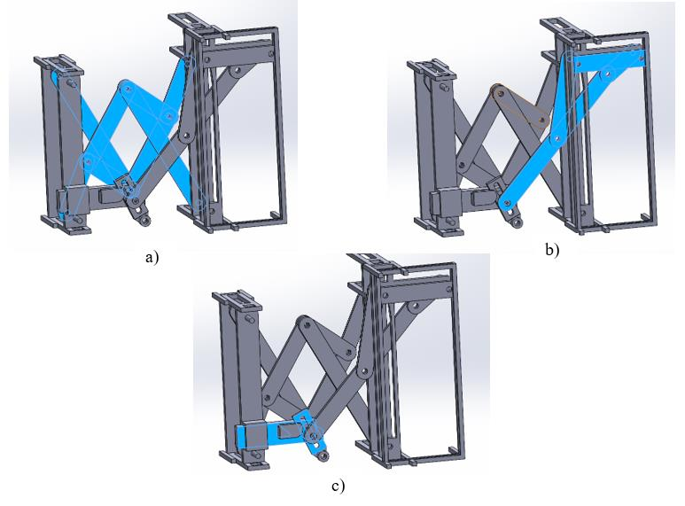
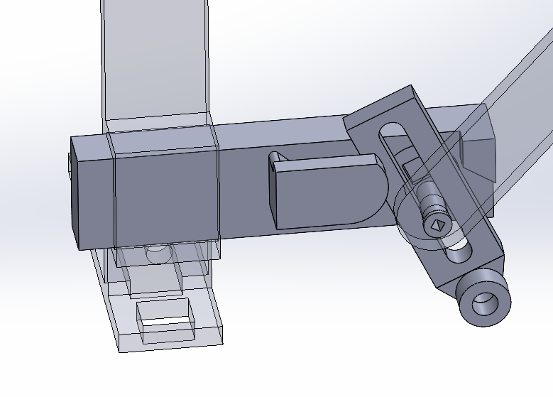
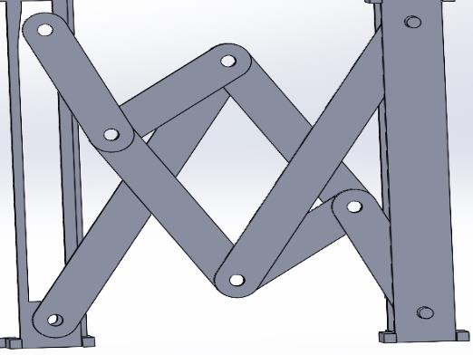
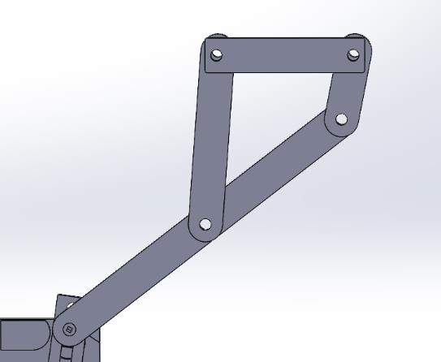
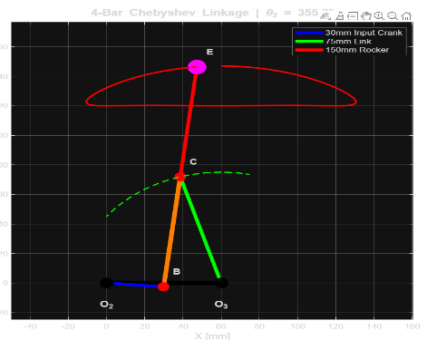
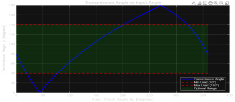
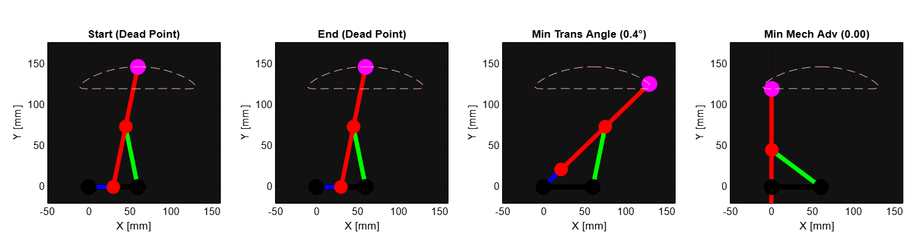
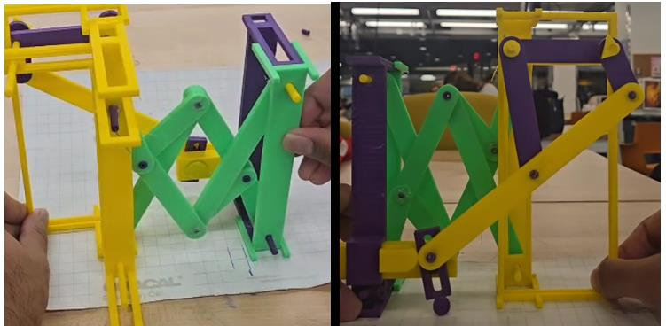

# Retracting Track Mechanism for Mobile Robots

**ME 5250 — Robotics Mechanics and Control, Northeastern University (Fall 2025), Project 1**

A multi-linkage mechanism I designed that pulls a robot's tracks in toward its body. While the
tracks retract, it deploys small auxiliary wheels so the tracks don't scrape sideways across the ground.
I took it from linkage synthesis through mobility, kinematic and singularity analysis to a SolidWorks
model and a working 3D-printed prototype.

   
  ▶ <a href="https://youtu.be/18wIrvqWMg4">Watch the prototype demo</a>

## The problem

Tracks are built to move tangentially. Retracting them means moving them perpendicular to that
direction, and the resulting drag friction can exceed actuator limits, wear out parts, or stop the
retraction entirely.

## The design

Two linked sub-mechanisms work together:

| Sub-mechanism | Role |
|---|---|
| **10-bar retraction linkage** | Moves the track in and out and folds up compactly. Adapted from a design by [Jeremy Fielding](https://www.youtube.com/@Jeremy_Fielding) |
| **Chebyshev λ 4-bar linkage** | Lowers the auxiliary wheels during retraction and raises them again when the track reaches full extension |
| **Connecting system** | A slot follower on a revolute joint inside a prismatic guide. It converts the Chebyshev coupler's return stroke into rotation of the auxiliary wheel assembly |

The timing is purely mechanical, so the auxiliary wheels only touch the ground while the track is retracting.

   
  SolidWorks model: (a) 10-bar linkage, (b) Chebyshev 4-bar linkage, (c) prismatic and slot joint

<table>
  <tr>
    <td width="33%"></td>
    <td width="33%"></td>
    <td width="33%"></td>
  </tr>
  <tr>
    <td align="center">Connecting system</td>
    <td align="center">10-bar linkage (10 links, 12 joints)</td>
    <td align="center">Chebyshev 4-bar</td>
  </tr>
</table>

## Analysis

**Mobility (Grübler):**

| Mechanism | Links | Joints | DOF |
|---|---|---|---|
| 10-bar linkage, floating | 10 | 12 | 3 |
| 10-bar linkage, grounded (added prismatic) | 10 | 13 | 1 |
| Chebyshev 4-bar | 4 | 4 | 1 |
| Full system, grounded | 15 | 20 | 3 (retraction, connector rotation, connector slide) |

**Chebyshev 4-bar:**
- **Grashof check:** S + L = 180 mm > P + Q = 135 mm, so it's a non-Grashof double-rocker. Its oscillation is limited, which suits controlled deployment.
- **Forward kinematics:** loop-closure and law-of-cosines equations map the input crank angle θ₂ to every joint position. The input crank swings about 200° between two dead points.
- **Auxiliary wheel path (point E):** it moves 30 mm vertically and 140 mm horizontally. That's enough to lift the tracks during retraction and clear the ground when retracted.
- **Singularities:** the dead points fall at the ends of the range, so they act as natural mechanical stops. The transmission angle stays within 40°–140° across most of the workspace, and the Jacobian shows no internal singularities.

  
  

  

## Prototype

The 3D-printed prototype runs through the full range of motion. It shows the auxiliary wheels
deploying in sync with retraction, which confirms the friction-reduction idea and matches the analysis.

  

## Limitations and next steps

- The DOF is unfavourable in some configurations, and keeping the two sub-mechanisms in sync needs proper timing belts.
- Driving everything from a single actuation point creates unwanted torque.
- **Next steps:** merge both sub-mechanisms into one 1-DOF retraction system, and move from planar to spatial linkages to shrink the Chebyshev mechanism's footprint.

## Files

| File | Contents |
|---|---|
| [`Project_1_ME5250.pdf`](Project_1_ME5250.pdf) | Full report: literature survey, design, analysis, references |
| [`images/`](images/) | CAD renders, analysis plots and prototype photos from the report |
| Demo video | [YouTube](https://youtu.be/18wIrvqWMg4) (the 131 MB source file is too large for GitHub) |
